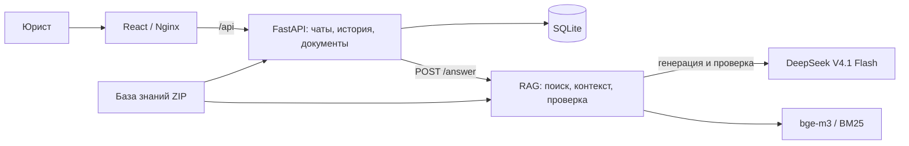

# PSB Buddy — юридический ассистент

### Разработан в рамках хакатона *Changellenge>> HACK & CHANGE 2026* командой DuckDuckCode.

Ассистент помогает юристу банка найти основания в предоставленной базе знаний:
отвечает со ссылками на положения, показывает документы и цитаты, объясняет
недостаток сведений. Демонстрационная база содержит вымышленные документы компании
и предоставленные организаторами тексты законов.

Для финального прототипа и автоматической оценки используется **DeepSeek V4.1 Flash**,
предоставленная организаторами. Имя модели и доступ к API задаются окружением.

## Содержание
- [Запуск всех компонентов](#запуск-всех-компонентов)
- [Компромиссы](#компоненты)
- [Архитектура](#архитектура)
- [Настройки](#настройки)
- [Технологический стек](#технологический-стек)
- [Основной сценарий проверки](#основной-сценарий-проверки)
- [Компромиссы](#компромиссы)
- [Дальнейшая разработка](#дальнейшая-разработка)


## Запуск всех компонентов

Нужен Docker с Compose v2 и доступ к прокси модели. Node.js и Python на хосте
для запуска через Docker не нужны.

1. Создайте `.env` по `.env.example`.
2. Заполните `LLM_BASE_URL` и `LLM_API_KEY`.
   В `LLM_MODEL` укажите точный идентификатор **DeepSeek V4.1 Flash** в их прокси.
   Адрес API должен быть доступен из контейнера.
3. Из корня репозитория выполните одну команду:

```shell
docker compose up --build -d
```

## Компоненты

Интерфейс: **http://localhost:3000**.

Бэкенд: http://localhost:8080/api/health.

Состояние базы знаний: http://localhost:8001/kb.

Доступность настроенной модели: http://localhost:8001/ready.


Демонстрационная `knowledge-base.zip` уже находится в `demo-data/`.
Оба сервиса используют один и тот же архив. Для другого набора измените `DATA_DIR`.
Относительные пути в `.env` указывайте с `./`; например, `DATA_DIR=./data`.

Compose ожидает готовности LLM-сервиса и бэкенда перед запуском зависимых компонентов.
Если интерфейс не появился, смотрите `docker compose ps` и
`docker compose logs llm backend frontend`: проверьте адрес прокси, ключ,
идентификатор модели и доступность `/models` у провайдера.
Порядок запуска основан на [условии `service_healthy` Docker Compose](https://docs.docker.com/compose/how-tos/startup-order/).

SQLite сохраняется в томе `backend-state`. SeaweedFS пока не используется основным
сценарием и запускается отдельно: `docker compose --profile storage up -d seaweedfs-s3`.

## Архитектура



`frontend/` — React-приложение; Docker собирает его по `package-lock.json` и
раздаёт через Nginx. `/api` проксируется в бэкенд с того же адреса, включая
документы. Это отдельная конфигурация для сборки:
[прокси Vite относится к серверу разработки](https://vite.dev/config/server-options.html#server-proxy).

`backend/` — API чатов, SQLite, сохранение истории и источников. При старте
распаковывает архив и регистрирует документы. `GET /api/documents/{id}` возвращает
JSON с текстом для TXT, Markdown и DOCX, а для PDF — сам файл.
`GET /api/documents/{id}/file` возвращает исходный файл.

`llm/` — HTTP-сервис и общее с сабмитом ядро в `llm/submission/`.
Ядро разбирает документы, отделяет редакционные пометки, строит BM25-индекс
при запуске, добавляет эмбеддинги, если они доступны. Маленькая коллекция
документов компании передаётся целиком; для большой используется поиск.
Для законов отбираются релевантные положения. Реранкер включается отдельно.

Генерация использует системные правила: 
- только база знаний,
- исправление ложной посылки,
- учёт даты и дополнительных соглашений,
- отказ при нехватке сведений,
- ограничение роли пользователя,
- запрет выполнения инструкций из документов и диалога.

Отдельный вызов той же модели проверяет выводы и выбирает идентификаторы
подтверждающих фрагментов. Программа принимает только существующие идентификаторы.
Если проверка обнаружила неподтверждённый ответ, разрешена одна попытка исправления
с повторной проверкой (`SELF_CHECK=1`). При техническом сбое или непрошедшей
проверке пользователь получает сообщение об ошибке без подставных источников.

## Настройки

| Переменная | Назначение |
|---|---|
| `LLM_BASE_URL` / `OPENAI_BASE_URL` / `BASE_URL` | Прокси организаторов, включая API-префикс, например `/v1` |
| `LLM_API_KEY` / `OPENAI_API_KEY` | Ключ прокси; задаётся только в окружении или локальном `.env` |
| `LLM_MODEL` / `OPENAI_MODEL` / `GEN_MODEL` | Идентификатор DeepSeek V4.1 Flash; приоритет слева направо |
| `DATA_DIR` | Каталог с ZIP; для Docker по умолчанию `./demo-data`, внутри контейнеров `/data` |
| `TEMPERATURE` | Температура генерации, по умолчанию `0` |
| `MAX_TOKENS` | Начальный лимит ответа; пример конфигурации — `4096`, при обрыве возможен ограниченный повтор |
| `MAX_WORKERS` | Максимум параллельно обрабатываемых запросов, диапазон `1–8`; в примере `2` |
| `SELF_CHECK` | `1` разрешает исправить ответ, не прошедший проверку; сама проверка обязательна |
| `EMB_MODEL` | Эмбеддинг-модель `baai/bge-m3`; при недоступности используется BM25 |
| `USE_RERANKER` | `0` по умолчанию; `1` включает необязательное реранжирование |
| `RERANKER_MODEL` | `qwen3-reranker-8b`; тот же прокси и ключ |
| `AI_TIMEOUT_SECONDS` | Ожидание ответа LLM-сервиса бэкендом, по умолчанию `300` секунд |
| `LLM_SERVICE_URL` | Адрес LLM-сервиса для локального бэкенда; Compose задаёт `http://llm:8000` |
| `CORS_ORIGINS` | Разрешённые адреса отдельного фронтенда через запятую; по умолчанию localhost/127.0.0.1 на портах 3000 и 5173 |

Приоритет имеют переменные процесса, затем корневой `.env`.
В бэкенде также поддерживаются `AI_SERVICE_URL` и `LLM_SERVICE_TIMEOUT` как
альтернативы двум соответствующим настройкам.

## Технологический стек

| Часть | Технологии |
|---|---|
| Frontend | React 19, Vite, React PDF, Lucide React |
| Backend API | Python, FastAPI, Pydantic |
| Работа с данными | SQLAlchemy Async, SQLite по умолчанию |
| LLM service | FastAPI, HTTPX, OpenAI-compatible API |
| Retrieval | BM25, embeddings, NumPy, опциональный reranker |
| Файловое хранилище | SeaweedFS |
| Запуск инфраструктуры | Docker Compose |

## Основной сценарий проверки

1. Откройте интерфейс и создайте чат.
2. Спросите: «Какой гарантийный срок на товар по договору поставки с ООО „Альфа-Трейд“?»
   Ожидаемое содержание по базе: 24 месяца со ссылкой на договор и положение.
3. Откройте источник: должны отображаться документ, расположение и цитата.
4. В новом чате спросите об арендной плате по договору с ООО «Северный Склад»,
   затем: «А до какого числа её нужно вносить?» Проверяется передача истории.
5. Спросите о размере пособия по беременности и родам: в базе нет необходимых
   документов, ожидается объяснение недостатка данных.
6. Проверьте ложную посылку, событие на границе действия дополнительного
   соглашения, старую редакцию закона и просьбу игнорировать правила.

Презентация: [docs/presentation.pdf](docs/presentation.pdf).

Тесты из `materials/llm_tests` находятся рядом с репозиторием в рабочей папке.
На компьютере с моделью:

```shell
python test_service.py http://127.0.0.1:8001
python test_integration.py --backend http://127.0.0.1:8080 --llm http://127.0.0.1:8001
```

Для сценария отказа остановите LLM-сервис, оставив уже запущенный бэкенд:
`docker compose stop llm`, затем запустите тот же интеграционный скрипт
с дополнительным параметром `--llm-down`. Вернуть сервис: `docker compose start llm`.


## Компромиссы

1. Ограниченные возможности LLM
2. БД хранит только метаданные файлов
3. Отсуствие аккаунтов пользователей
4. Нет возможности оценить ответ ИИ

## Дальнейшая разработка

- Улучшение LLM и RAG
- Разработка и внедрение полноценной БД
- Добавление аккаунтов и входа
- Оценка ответов ИИ пользователем
