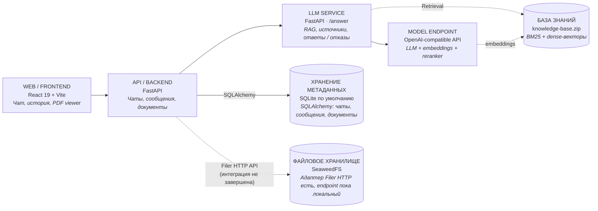

# Юридический консультант
Прототип AI-ассистента для поиска ответов по внутренним документам и нормативным материалам. Пользователь задаёт вопрос в чате, а RAG-сервис подбирает релевантные фрагменты базы знаний и возвращает ответ вместе с источниками.

Разработан в рамках хакатона Changellenge>> HACK & CHANGE 2026

## Содержание
- [Команда](#команда)
- [Возможности и состав проекта](#возможности-и-состав-проекта)
- [Технологический стек](#технологический-стек)
- [Архитектура](#архитектура)
- [Настройка окружения](#настройка-окружения)
- [Запуск](#запуск)
- [API](#api)
- [Проверки](#проверки)
- [Структура проекта](#структура-проекта)
- [Компромиссы](#компромиссы)
- [Дальнейшая разработка](#дальнейшая-разработка)

## Команда
|Участник|Роль|
|---|---|
|[Гредасов Илья](https://github.com/IlyaGredasov)|ML|
|[Макаренко Эвелина](https://github.com/MakarenkoEP)|ML|
|[Егорцев Максим](https://github.com/vulkan790)|frontend|
|[Сазоненко Дмитрий](https://github.com/Axcellent)|backend|
|[Митерева Критина](https://github.com/Rinalon)|backend|

## Возможности и состав проекта

- **Frontend:** веб-интерфейс чата, список диалогов, отображение ответов и источников, просмотр PDF.
- **Backend:** REST API на FastAPI для создания, получения и удаления чатов, работы с сообщениями и выдачи файлов документов; SQLAlchemy используется для хранения чатов и сообщений.
- **LLM/RAG service:** отдельный FastAPI-сервис с эндпоинтами для ответа по базе знаний и прямого обращения к OpenAI-compatible Chat Completions API.
- **Retrieval:** гибридный поиск по BM25 и dense-векторам; при доступности reranker используется дополнительное ранжирование найденных фрагментов.
- **Object storage:** в проекте присутствует адаптер SeaweedFS Filer HTTP API и Docker Compose-конфигурация SeaweedFS.

## Технологический стек

| Часть | Технологии |
|---|---|
| Frontend | React 19, Vite, React PDF, Lucide React |
| Backend API | Python, FastAPI, Pydantic |
| Работа с данными | SQLAlchemy Async, SQLite по умолчанию |
| LLM service | FastAPI, HTTPX, OpenAI-compatible API |
| Retrieval | BM25, embeddings, NumPy, опциональный reranker |
| Файловое хранилище | SeaweedFS |
| Запуск инфраструктуры | Docker Compose |

## Архитектура


## Настройка окружения

### 1. Клонирование репозитория

```bash
git clone https://github.com/Axcellent/psb-buddy.git
cd psb-buddy-main
```

### 2. Переменные окружения

Создайте `.env` в корне проекта на основе `.env.example`:

```bash
cp .env.example .env
```

В Windows PowerShell:

```powershell
Copy-Item .env.example .env
```

Основные параметры:

| Переменная | Назначение |
|---|---|
| `LLM_BASE_URL` | Базовый URL OpenAI-compatible API, обычно с `/v1` |
| `LLM_API_KEY` | Ключ доступа к LLM API |
| `LLM_MODEL` | Идентификатор модели, доступный на указанном endpoint |
| `EMB_MODEL` | Модель эмбеддингов; в примере — `baai/bge-m3` |
| `RERANKER_MODEL` | Модель reranker |
| `USE_RERANKER` | Включение дополнительного ранжирования (`1` / `0`) |
| `DATA_DIR` | Каталог с файлами базы знаний; по умолчанию `data` |
| `TEMPERATURE` | Температура генерации |
| `MAX_TOKENS` | Максимальное число токенов ответа |
| `MAX_WORKERS` | Ограничение параллельных запросов |

Значения в `.env.example` являются примером. Укажите модель и ключ, которые действительно доступны на вашем LLM endpoint. Не коммитьте `.env` и реальные секреты в репозиторий.

### 3. База знаний

Создайте каталог `data` в корне проекта и поместите туда архив базы знаний:

```text
data/
└── knowledge-base.zip
```

RAG-сервис ищет архив с одним из имён: `knowledge-base.zip`, `kb.zip` или `knowledge_base.zip`. Путь можно переопределить переменной `KB_PATH`. Если архив не найден или не загрузился, эндпоинт `/kb` сообщит, что база знаний не загружена, а `/answer` вернёт ошибку `503`.

### 4. Конфигурация SeaweedFS

В `docker-compose.yaml` используется файл `scripts/seaweedfs/example-s3-config.json`. Эта конфигурация S3 API используется в нашем решении.

## Запуск

### Инфраструктура и LLM-сервис

После настройки `.env` и размещения базы знаний выполните из корня репозитория:

```bash
docker compose up --build -d
```

Текущий Compose запускает два сервиса:

- SeaweedFS: Filer HTTP API на `http://localhost:8888`, S3 API на `http://localhost:8333`;
- LLM/RAG service: `http://localhost:8001` (внутри контейнера порт `8000`).

Проверка состояния:

```bash
docker compose ps
docker compose logs -f llm
```

Проверить LLM-сервис можно запросами:

```bash
curl http://localhost:8001/health
curl http://localhost:8001/kb
curl http://localhost:8001/ready
```

`/health` проверяет доступность приложения, `/kb` показывает состояние загруженной базы знаний, `/ready` дополнительно проверяет доступность и наличие настроенной генеративной модели на upstream endpoint.
```bash
uvicorn main:app --reload --host 0.0.0.0 --port 8000
```

Backend будет доступен по адресу `http://localhost:8000`, документация Swagger UI — `http://localhost:8000/docs`, проверка состояния — `http://localhost:8000/api/health`.

По умолчанию используется SQLite-файл `app.db` в рабочем каталоге backend. Путь подключения можно изменить переменной `DATABASE_URL`.

### Frontend

В отдельном терминале из корня репозитория:

```bash
cd frontend
npm install
npm run dev
```

Vite выведет адрес локального dev-сервера (обычно `http://localhost:5173`). Для production-сборки:

```bash
npm run build
```

Для локального просмотра собранной версии:

```bash
npm run preview
```

## API

### Backend

Базовый URL при локальном запуске: `http://localhost:8000`.

| Метод | Endpoint | Назначение |
|---|---|---|
| `GET` | `/api/health` | Проверка состояния backend |
| `GET` | `/api/chats` | Получить список чатов |
| `POST` | `/api/chats` | Создать чат |
| `DELETE` | `/api/chats/{chat_id}` | Удалить чат |
| `GET` | `/api/chats/{chat_id}/messages` | Получить сообщения чата |
| `POST` | `/api/chats/{chat_id}/messages` | Отправить сообщение |
| `GET` | `/api/documents/{doc_id}/file` | Получить файл документа с локального диска |

Интерактивная схема API доступна по адресу `/docs` после запуска backend.

### LLM/RAG service

Базовый URL при локальном запуске: `http://localhost:8001`.

| Метод | Endpoint | Назначение |
|---|---|---|
| `GET` | `/health` | Проверка доступности сервиса |
| `GET` | `/ready` | Проверка upstream LLM endpoint и модели |
| `GET` | `/kb` | Состояние базы знаний и retrieval-индекса |
| `POST` | `/answer` | Ответ на вопрос по базе знаний с источниками |
| `POST` | `/chat` | Прямой запрос к Chat Completions API |
| `WS` | `/chat/ws` | Потоковый чат через WebSocket |

Пример запроса к RAG-эндпоинту:

```bash
curl -X POST http://localhost:8001/answer \
  -H "Content-Type: application/json" \
  -d '{
    "question": "Какие документы регулируют процесс?",
    "history": []
  }'
```

Ответ содержит текст, список источников и режим формирования ответа. Фактическое содержимое ответа зависит от загруженной базы знаний и доступности настроенных моделей.

## Проверки

Тесты backend находятся в `backend/tests`. После установки тестовых зависимостей их можно запускать из каталога `backend`:

```bash
python -m pytest
```

Для проверки frontend:

```bash
cd frontend
npm run lint
npm run build
```

## Структура проекта
```
psb-buddy/
├── .env.example
├── .gitignore
├── docker-compose.yaml
└── README.md
├───backend
│   ├───.env.example
│   ├───db.py
│   ├───main.py
│   ├───models.py
│   ├───rag.py
│   ├───repos.py
│   ├───requirements.txt
│   ├───schemas.py
│   ├───seed_docs.py
│   └───services.py
│   │   
│   ├───app
│   │   └───config.py
│   │   │   
│   │   └───services
│   │       ├───seaweedfs.py
│   │       └───txt_parser.py
│   │           
│   ├───routers
│   │   ├───schats.py
│   │   ├───documents.py
│   │   └───messages.py
│   │   
│   └───tests
│       └───test_txt_parser.py
│ 
├───frontend
│   ├───.gitignore
│   ├───index.html
│   ├───package-lock.json
│   ├───package.json
│   ├───psb.svg
│   └───vite.config.js
│   │   
│   ├───public
│   │   └───document
│   │       └───rules.pdf
│   └───src
│       ├───App.jsx
│       ├───main.jsx
│       └───styles.css
├───llm
│   ├───.dockerignore
│   ├───app.py
│   ├───Dockerfile
│   ├───pyproject.toml
│   ├───rag_service.py
│   ├───requirements.txt
│   └───uv.lock
│   │   
│   └───submission
│       ├───assistant.py
│       ├───config.py
│       ├───editions.py
│       ├───examples.py
│       ├───grounding.py
│       ├───kb.py
│       ├───llm_client.py
│       ├───pack.py
│       ├───prompts.py
│       ├───requirements.txt
│       ├───retrieval.py
│       └───solution.py
└───scripts
    └───seaweedfs
        ├───example-s3-config.json
        └───s3-config.json
```

## Компромиссы

1. Ограниченные возможности LLM
2. БД хранит только метаданные файлов
3. Отсуствие аккаунтов пользователей
4. Нет возможности оценить ответ ИИ

## Дальнейшая разработка

- Улучшение LLM и RAG
- Разработка и внедрение полноценной БД
- Добавление аккаунтов и входа
- Оценка ответов ИИ пользователем
